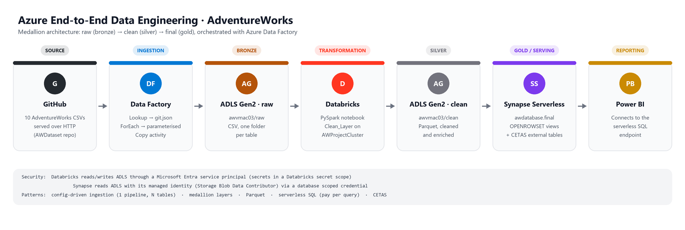
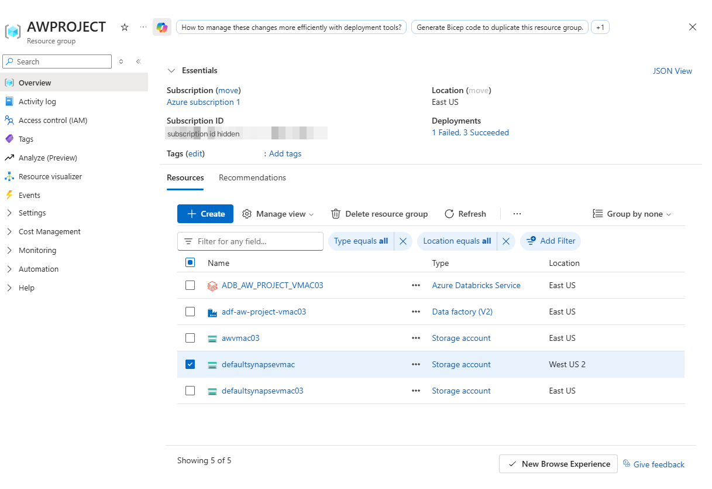
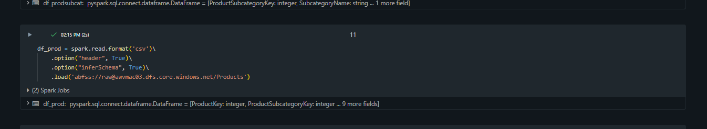
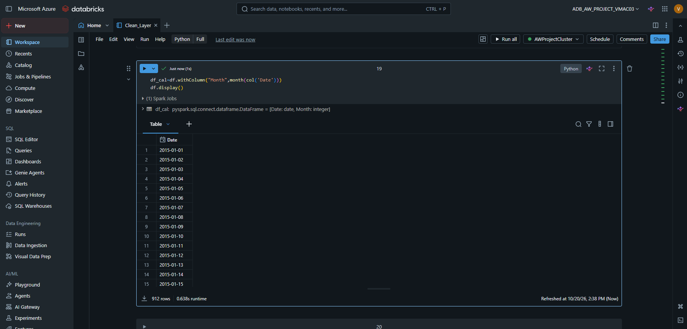
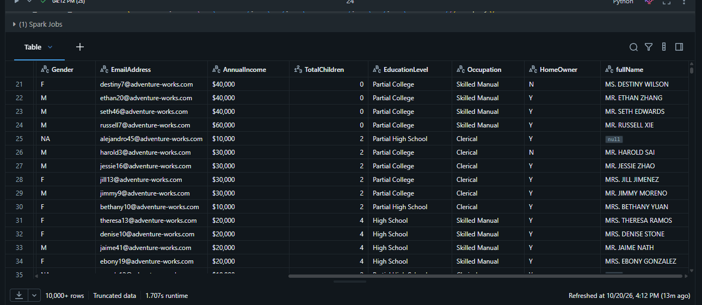
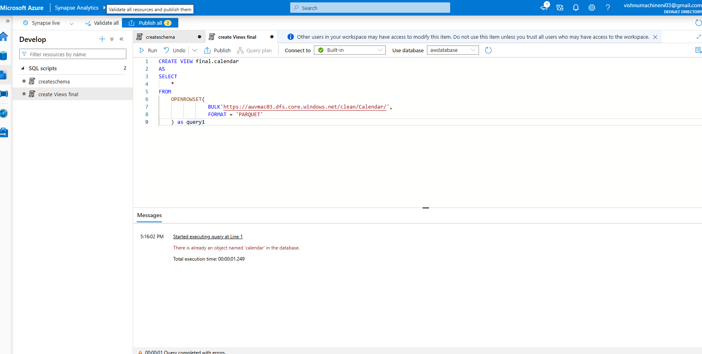
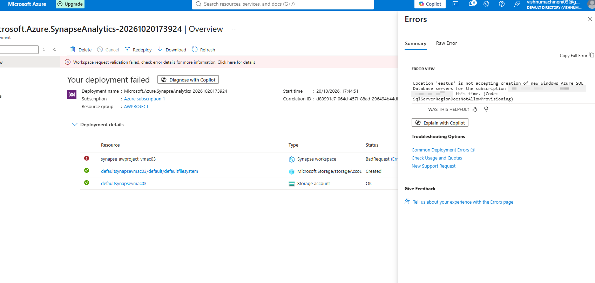
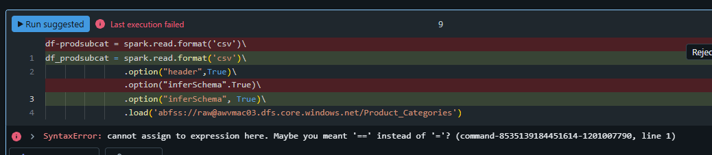
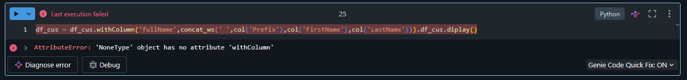
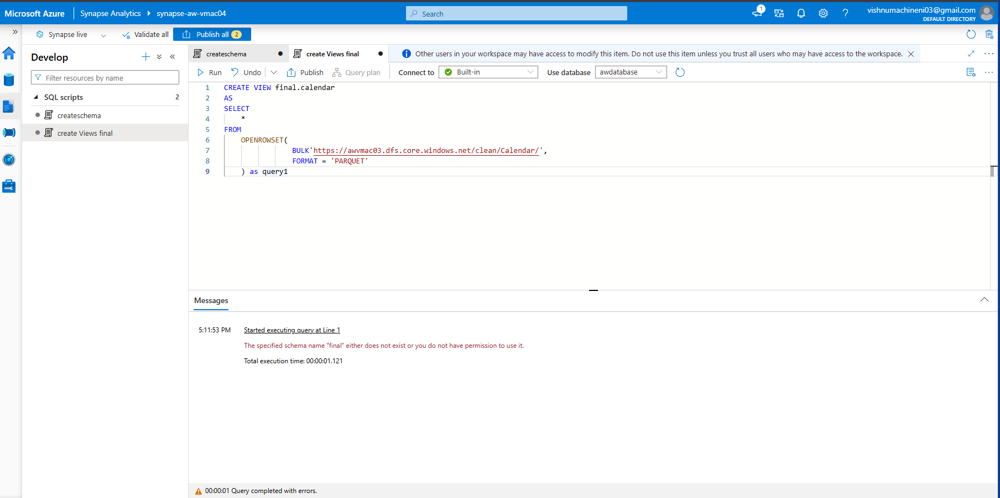

# Azure End-to-End Data Engineering Project · AdventureWorks


An end-to-end batch pipeline on Microsoft Azure. It ingests the AdventureWorks sales dataset from GitHub
with a **config-driven Azure Data Factory pipeline**, cleans and enriches it with **PySpark on Azure Databricks**,
and serves it through **Azure Synapse serverless SQL** views and external tables for **Power BI**,
following the **medallion architecture** (raw → clean → final).



## What this project demonstrates

- **Dynamic ingestion.** One parameterised Data Factory pipeline loads all 10 tables. Adding a table means adding one line to a JSON control file, not building a new pipeline.
- **Medallion lakehouse on ADLS Gen2.** Separate `raw`, `clean` and `final` containers, with CSV in bronze and Parquet in silver and gold.
- **Distributed transformations.** PySpark cleaning, type casting, enrichment and aggregation on a Databricks cluster.
- **Serverless data warehousing.** Synapse reads Parquet in place with `OPENROWSET` views and materialises gold tables with `CETAS`.
- **Secure service-to-service access.** A service principal for Databricks and managed identities for Data Factory and Synapse, with no storage keys in code.
- **Real troubleshooting.** Region capacity limits, Spark errors and re-runnable SQL, documented [below](#challenges-and-how-i-solved-them).

## Tech stack

| Layer | Service | What it does here |
|---|---|---|
| Source | GitHub (HTTP) | 10 AdventureWorks CSV files ([VISHNUMAC03/AWDataset](https://github.com/VISHNUMAC03/AWDataset)) |
| Ingestion | Azure Data Factory | Lookup + ForEach + parameterised Copy activity |
| Storage | Azure Data Lake Storage Gen2 | `raw`, `clean` and `final` containers on account `awvmac03` |
| Transformation | Azure Databricks · PySpark | `Clean_Layer` notebook on `AWProjectCluster` |
| Serving | Azure Synapse Analytics (serverless SQL) | `awdatabase`, schema `final`: views + external tables |
| Reporting | Power BI | Connects to the Synapse serverless SQL endpoint |
| Security | Microsoft Entra ID | Service principal, managed identities, RBAC (Storage Blob Data Contributor) |

## Azure resources

All resources live in one resource group, `AWPROJECT`.



## 1. Bronze: dynamic ingestion with Azure Data Factory

Instead of one Copy activity per file, the pipeline reads a control file and loops over it.

```
LookupGit (reads git.json, first row only = false)
   └── ForEachGit (items = @activity('LookupGit').output.value, parallel)
          └── CopyRawData: HTTP (GitHub) ➜ ADLS raw/<p_Sink_Folder>/<p_Sink_File>
```

Each entry in [`adf/control/git.json`](adf/control/git.json) describes one table:

```json
{
    "p_rel_url": "VISHNUMAC03/AWDataset/refs/heads/main/data/AdventureWorks_Returns.csv",
    "p_Sink_Folder": "Returns",
    "p_Sink_File": "Returns.csv"
}
```

The pipeline, datasets and linked services are in [`adf/`](adf). The HTTP source dataset takes `p_rel_url`, and the
ADLS sink dataset takes `p_sink_folder` and `p_sink_file`. Both are filled from `@item()` inside the loop.

## 2. Silver: transformations with Azure Databricks

[`databricks/Clean_Layer.py`](databricks/Clean_Layer.py) reads every table from `raw`, transforms it, and writes Parquet to `clean`.



| Table | Transformation |
|---|---|
| Calendar | Added `Month` and `Year` columns |
| Customers | Built `fullName` from `Prefix`, `FirstName` and `LastName` with `concat_ws` |
| Products | Kept the SKU family (`split` on `-`) and the first word of the product name |
| Sales (2015–2017) | Read all three years with one wildcard path, cast `StockDate` to timestamp, re-prefixed `OrderNumber` (S → T), added a line-level `multiply` column |
| All tables | Written as Parquet to `clean/<Table>/` with `overwrite`, so the notebook is safe to re-run |





## 3. Gold: serving with Azure Synapse serverless SQL

The `final` schema exposes the clean Parquet files as SQL views ([`synapse/02_create_views.sql`](synapse/02_create_views.sql)).
Nothing is copied: serverless SQL reads the files in place and bills per query.

```sql
CREATE OR ALTER VIEW final.calendar AS
SELECT * FROM OPENROWSET(
    BULK 'https://awvmac03.dfs.core.windows.net/clean/Calendar/',
    FORMAT = 'PARQUET'
) AS query1;
```



*Re-running the original `CREATE VIEW` showed the view already existed in `awdatabase`. That is why the scripts in this repository use `CREATE OR ALTER`.*

For downstream tools, [`synapse/03_external_tables.sql`](synapse/03_external_tables.sql) sets up a managed-identity credential,
external data sources and a Parquet file format. A **CETAS** statement then materialises `final.extsales` back to the lake.
[`synapse/04_analysis_queries.sql`](synapse/04_analysis_queries.sql) answers example business questions from the gold layer.

## 4. Reporting: Power BI

Power BI connects to the Synapse **serverless SQL endpoint**, reads `awdatabase` and queries the `final` views and external tables.

## Security and access

| From | To | How |
|---|---|---|
| Data Factory | ADLS Gen2 | System-assigned managed identity |
| Databricks | ADLS Gen2 | Microsoft Entra service principal, OAuth. Secrets come from a Databricks secret scope (`dbutils.secrets.get`) |
| Synapse | ADLS Gen2 | Workspace managed identity through a database scoped credential |
| Every identity | Storage account | `Storage Blob Data Contributor` role assignment |

No keys, secrets or passwords are committed to this repository.

## Challenges and how I solved them

**1. Synapse would not deploy in East US.** The workspace deployment failed with `SqlServerRegionDoesNotAllowProvisioning`:
the region was not accepting new SQL servers for my subscription. I redeployed the workspace in **West US 2**, which is why its default storage account lives in a different region from the rest of the resource group.



**2. A hyphen in a variable name.** `df-prodsubcat = spark.read...` raised `SyntaxError: cannot assign to expression`, because Python reads the `-` as subtraction. I renamed it to `df_prodsubcat`.



**3. `display()` returns `None`.** Chaining `.display()` onto a transformation, as in `df_cus = df_cus.withColumn(...).display()`, overwrote the DataFrame with `None`.
The next cell then failed with `'NoneType' object has no attribute 'withColumn'`. I now assign the transformation first and display it on a separate line.



**4. Schema must exist before its views.** Creating `final.calendar` before the `final` schema existed failed. The scripts are now numbered and run in order.
They also use `IF NOT EXISTS` and `CREATE OR ALTER`, so re-running them never fails with "object already exists".



## Repository structure

```
├── adf/
│   ├── control/git.json                    # one entry per table: source URL, sink folder, sink file
│   ├── pipeline/pl_dynamic_git_to_raw.json # Lookup → ForEach → Copy
│   ├── dataset/                            # parameterised HTTP source, ADLS sink, JSON control file
│   └── linkedService/                      # GitHub (HTTP) and ADLS Gen2 (managed identity)
├── databricks/Clean_Layer.py               # raw → clean PySpark notebook (Databricks source format)
├── synapse/
│   ├── 01_create_schema.sql
│   ├── 02_create_views.sql                 # OPENROWSET views over clean Parquet
│   ├── 03_external_tables.sql              # credential, data sources, file format, CETAS
│   └── 04_analysis_queries.sql
├── architecture/architecture.png
└── screenshots/
```

## How to reproduce

1. Create a resource group with an ADLS Gen2 storage account (hierarchical namespace on) and the containers `parameters`, `raw`, `clean` and `final`.
2. Upload [`adf/control/git.json`](adf/control/git.json) to the `parameters` container.
3. Create a Data Factory, give its managed identity **Storage Blob Data Contributor** on the storage account, and import the JSON in [`adf/`](adf) (or rebuild it in ADF Studio). Run `pl_dynamic_git_to_raw`.
4. Create a Databricks workspace and cluster. Register an app (service principal), grant it **Storage Blob Data Contributor**, and store its client ID, tenant ID and secret in a secret scope named `aw-project-scope`. Import and run [`databricks/Clean_Layer.py`](databricks/Clean_Layer.py).
5. Create a Synapse workspace, grant its managed identity **Storage Blob Data Contributor**, create a serverless database `awdatabase`, and run the scripts in [`synapse/`](synapse) in order.
6. In Power BI, choose **Get data → Azure Synapse Analytics SQL**, enter the serverless SQL endpoint and database `awdatabase`, and load the `final` views.

## What I would add next

- A schedule or storage-event trigger on the Data Factory pipeline, plus a Databricks activity, so a single pipeline runs bronze → silver end to end.
- Incremental loads with watermarks instead of full reloads.
- Delta Lake tables in silver for ACID writes and time travel, governed with Unity Catalog.
- Azure Key Vault-backed secret scopes, and CI/CD for Data Factory with Git integration and ARM template deployment.
- Automated data-quality checks (row counts, nulls, referential integrity) between layers.

## Credits

Built by following Ansh Lamba's [Azure End-To-End Data Engineering Project](https://www.youtube.com/watch?v=0GTZ-12hYtU) tutorial,
implemented in my own Azure subscription with my own naming, dataset repository and fixes.

## Author

**Vishnu Madhav Machineni**, data engineering enthusiast actively looking for full-time roles.
[Portfolio](https://vishnumac03.github.io/) · [LinkedIn](https://www.linkedin.com/in/vishnu-madhav-16ab6a1a2/) · vishnumachineni03@gmail.com
